# The Paper Phase Transition: an Ising model of digital adoption, solved exactly and with linear-ramp QAOA

*IQC 2026 · Vasion challenge · BYU, November 6–7, 2026*

## Abstract

We model each industry–region pair as an Ising spin $s_i\in\{-1,+1\}$ (paper, digital) with ferromagnetic partner couplings $J_{ij}\ge 0$ and a time-dependent field $A(y)-r_i$. The yearly ground state gives each node a flip year. Because every $J_{ij}\ge 0$, the energy is submodular and the ground state is an exact $s$–$t$ minimum cut, computed in polynomial time. We solve 5- to 1,920-node networks exactly and observe:

1. Partner couplings shift flip years by up to ±3 years.
2. 11 of 20 industries flip in a single year (2036).
3. Stronger couplings turn a gradual adoption curve into a discontinuous one.
4. Inter-region couplings of only $J=0.05$ synchronize regions.

We encode the same Hamiltonian on qubits and solve it with linear-ramp QAOA (a Trotterized quantum anneal) on a noiseless simulator. The quantum method reaches the ground energy in all 15 years for every network up to 20 qubits. Its per-shot success falls in years with a small spectral gap (Pearson $r=0.66$). Its state is entangled only along coupled edges: an uncoupled qubit is provably in a product state. Classically, minimum cut is faster at every size, and simulating the quantum circuit costs $O(2^n)$. We therefore claim no quantum advantage for this model, and identify which extensions would break the minimum-cut reduction.

The derivations follow the team's whiteboard work, reproduced in [`docs/whiteboard/`](../docs/whiteboard/). Every number below is regenerated by `python src/make_figures.py`.

---

## 1. Model

### 1.1 Energy

Let $G=(V,E)$ be the business network, $n=|V|$. For year $y$,

$$
E(\mathbf s; y) \;=\; -\sum_{(i,j)\in E} J_{ij}\, s_i s_j \;-\; \sum_{i\in V}\bigl(A(y)-r_i\bigr)\, s_i,
\qquad A(y)=0.07\,(y-2026).
$$

- **First term (industry relationship):** each coupled pair lowers the energy by $J_{ij}$ when it agrees and raises it by $J_{ij}$ when it disagrees.
- **Second term (AI pressure vs resistance):** being digital lowers the energy once $A>r_i$.

The economy in year $y$ is the ground state $\mathbf s^\*(y)=\arg\min_{\mathbf s} E(\mathbf s;y)$. Node $i$'s **flip year** is $y_i^\*=\min\{y: s_i^\*(y)=+1\}$.

**Monotonicity.** For $J_{ij}\ge 0$, $E$ is submodular. Raising the uniform field $A$ can only grow the set of digital nodes, because the minimum-cut sets are nested as source capacities increase and sink capacities decrease (parametric max-flow; Gallo, Grigoriadis & Tarjan, *SIAM J. Comput.* 18, 1989). So $y_i^\*$ is well defined: once digital, a node stays digital. We checked this numerically: 0 digital→paper reversals across all networks (5, 20, 240 and 1,920 nodes).

**Degeneracy.** Without noise, two arrangements can tie for the lowest energy. Example: the 16-industry sub-network in 2034 has exactly two ground states, differing only in whether {Banking, Accounting, Insurance} flip. That cluster sits precisely at its critical point. We therefore score solvers by **energy reached**, not by matching one particular optimal arrangement (§5.3).

### 1.2 Local-field rule: how a tie moves a threshold

Holding the neighbours fixed, node $i$ prefers digital iff its local field is positive:

$$
A - r_i + \sum_j J_{ij}\, s_j \;>\; 0
\quad\Longleftrightarrow\quad
A \;>\; r_i^{\text{eff}} \;=\; r_i - \sum_j J_{ij}\, s_j .
$$

A digital neighbour lowers node $i$'s effective resistance by $J_{ij}$, and a paper neighbour raises it by $J_{ij}$. This one line explains every "who pulls whom" result in §4.

### 1.3 Worked example (whiteboard, photos 02 and 04)

**One node.** Healthcare has $r=0.75$. At $A=0.50$, $A-r=-0.25$, so

- paper: $-(-0.25)(-1)=-0.25$;
- digital: $-(-0.25)(+1)=+0.25$.

Paper has the lower energy, as written on the board.

**Two coupled nodes.** Healthcare ($r_H=0.75$) and Insurance ($r_I=0.55$) are coupled with README strength 1.0, so $J=0.15\times1.0=0.15$. The board illustrates the sign with the raw strength 0.9; the model scales all strengths by 0.15. At $A=0.70$ (2036), the four energies are below. Each column is one term of $E$; we reproduced these numbers exactly in code.

| Healthcare | Insurance | $-(A-r_I)s_I$ | $-(A-r_H)s_H$ | $-J s_H s_I$ | $E$ |
|---|---|---|---|---|---|
| paper | paper | +0.15 | −0.05 | −0.15 | −0.05 |
| paper | digital | −0.15 | −0.05 | +0.15 | −0.05 |
| digital | paper | +0.15 | +0.05 | +0.15 | +0.35 |
| **digital** | **digital** | −0.15 | +0.05 | −0.15 | **−0.25** |

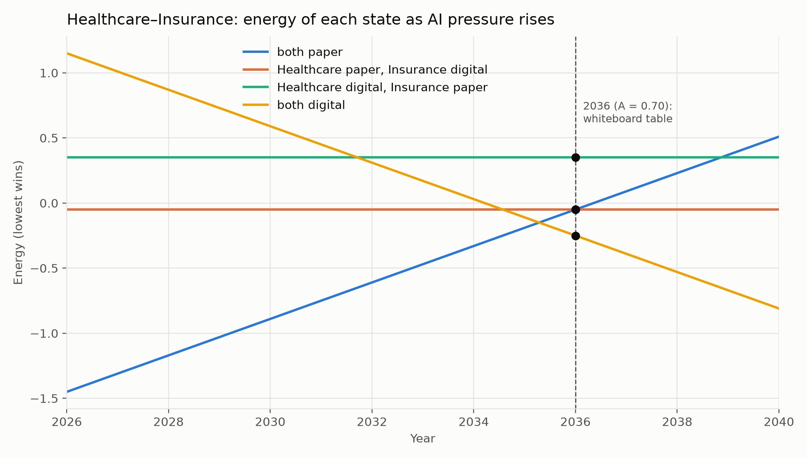

In closed form:

$$
E_{PP}=2A-r_H-r_I-J,\qquad E_{DD}=-2A+r_H+r_I-J,
$$
$$
E_{PD}=r_I-r_H+J,\qquad E_{DP}=r_H-r_I+J .
$$

The mixed states do not depend on $A$: the two field terms cancel, which is why they are flat lines in the figure. "Both digital" is the ground state iff

$$
A>\tfrac12(r_H+r_I)=0.65 \quad\text{and}\quad A>r_H-J=0.60 .
$$

So the pair flips at $A=0.65$ (2036). On its own, Healthcare needs $A>0.75$ (2037). The coupling pulls Healthcare forward one year, and holds Insurance back two years: it would flip alone at $A>0.55$ (2034).

### 1.4 Ferromagnet, not spin glass

$E$ is the energy function, the Hamiltonian, and the energy landscape is the set of its values over all $2^n$ arrangements. Raising $A$ tilts this landscape uniformly toward digital (the "tilt" picture on photo 03).

Because every $J_{ij}\ge0$, the model is a **ferromagnet in a heterogeneous (random) field**: a random-field Ising ferromagnet. It is **not a spin glass**. A spin glass needs *frustration*: a cycle of couplings whose signs cannot all be satisfied. The standard example is a triangle with two cooperative ties and one competitive tie, where at least one tie is always violated. Frustration creates the rugged, many-minima landscape that makes Ising minimization NP-hard, and it is the regime that quantum annealers target.

Our landscape has no frustration. That is exactly why minimum cut solves it exactly (§3), and why §6 lists competitive ties ($J_{ij}<0$) as the first extension where a quantum solver could matter.

### 1.5 Networks and parameters

| Network | $n$ | Couplings | Resistances |
|---|---|---|---|
| Utah (team model) | 5 | Healthcare–Government, Government–Education, $J=0.09$ each | README base values |
| One region | 20 | 24 README partner ties, $J=0.15\times$ strength | README base values |
| U.S. | 240 | per region as above, plus same industry in bordering regions, $J=0.05$ | base $+\,U(-0.15,0.15)$ per region $+\,\mathcal N(0,0.02^2)$ per node, seed 7 |
| Synthetic grids | 480–1,920 | as U.S., regions on a rectangular grid | as U.S. |

Resistances and tie strengths are the challenge's suggested values, not measurements. The Utah sources (DWS employer data, the Medicaid report, the FY2026 budget) justify which nodes and ties exist, not their magnitudes.

---

## 2. Qubit encoding

Map each spin to a qubit with $s_i \mapsto Z_i$, so $Z|0\rangle=+|0\rangle$ is **digital** and $|1\rangle$ is **paper**. The whiteboard (photo 03) labels the bits the other way round (0 = paper); the two conventions differ by a relabelling $X$ on every qubit. All code and figures use the $Z$-eigenvalue convention above. The problem Hamiltonian is diagonal in the computational basis:

$$
H_C(y)=\sum_i h_i Z_i+\sum_{(i,j)}\tilde J_{ij} Z_iZ_j,
\qquad h_i=-(A(y)-r_i),\quad \tilde J_{ij}=-J_{ij}.
$$

This is the solver sign convention used by Ocean/`dimod` and in `src/quantum_qaoa.py`:
- **Linear biases** are $-(A-r)$, the pressure term.
- **Quadratic biases** are $-J$, the ties.

The state space has dimension $2^n$ (photo 01: $2^2$ states $|00\rangle,\dots,|11\rangle$ for two industries). A state is fully described by its density matrix $\rho=|\psi\rangle\langle\psi|\in\mathbb C^{2^n\times2^n}$ (photo 01 sketches the $8\times8$ case):
- **diagonal entries** $\rho_{kk}$ are the probabilities of measuring arrangement $k$;
- **off-diagonal entries** are coherences between arrangements.

Because $H_C$ is diagonal, its ground state is a single basis state $|\mathbf s^\*\rangle$, with $\rho$ having one nonzero entry.

**Two terms we use precisely.**

- **Density matrix.** A density matrix is the $2^n\times2^n$ operator $\rho$ of a quantum state (fig. 09–10). It is not a table of industries against years: that is a tipping map (fig. 01).
- **Couplings vs entanglement.** The couplings $J_{ij}$ are classical interaction strengths, and a classical solver uses them with no entanglement at all. Entanglement is a property of the *quantum state* produced while solving. §5.5 shows that it forms only along coupled pairs, which is the precise sense in which "quadratic biases ↔ ties ↔ entanglement".

---

## 3. Classical solution: exact minimum cut

Add a source $D$ ("digital") and a sink $P$ ("paper"). With $h_i=A-r_i$:

- add edge $D\to i$ with capacity $2h_i$ if $h_i>0$;
- add edge $i\to P$ with capacity $-2h_i$ if $h_i<0$;
- add edges $i\leftrightarrow j$ with capacity $2J_{ij}$.

For the cut $S$ = nodes on $D$'s side (digital), its capacity $C(S)$ satisfies

$$
E(\mathbf s)=C(S)-\sum_i|h_i|-\sum_{(i,j)}J_{ij}.
$$

Why: a node aligned with its field contributes $-|h_i|$, and a misaligned one $-|h_i|+2|h_i|$. A matched pair contributes $-J_{ij}$, and a split pair $-J_{ij}+2J_{ij}$. Hence $\arg\min E=\arg\min C$, and the minimum cut is the exact ground state.

The construction needs $J_{ij}\ge0$: a negative capacity is not allowed. Max-flow runs in polynomial time; `networkx` uses preflow–push, $O(n^2\sqrt{|E|})$. Brute-force enumeration costs $\Theta(2^n(n+|E|))$. At 20 nodes both exact methods found the same energy in every year (asserted in code).

**Classical heuristic.** Simulated annealing (`dwave-neal`, 50 reads, default schedule) samples the Boltzmann distribution while lowering the temperature, escaping local minima by thermal hops. It is the classical counterpart of quantum annealing (photo 03, "thermal dynamic between classical and QC"). It runs entirely on a CPU, so a `dimod`/`neal` run is a classical result even though it uses D-Wave's Ocean SDK. Quantum results require a QPU (or, as here, a simulation of a quantum circuit).

Neither exact method "tries every combination": minimum cut finds the optimum through max-flow without enumerating arrangements, and only brute force enumerates.

---

## 4. Results from the model (exact)

**Ties shift flip years both ways.** By the local-field rule (§1.2), a stubborn node with eager partners flips early, and an eager node with stubborn partners flips late.

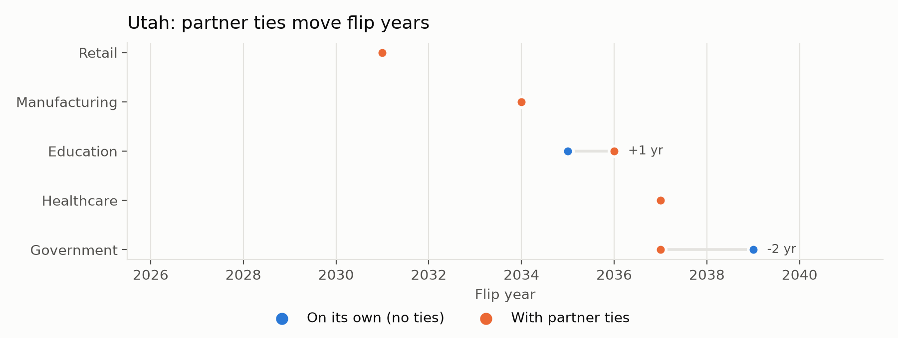

- **Utah:** Government 2039 → 2037 (pulled forward by Healthcare and Education), and Education 2035 → 2036 (held back by Government).
- **One region of 20 industries** ([fig. 03](figures/03_region_pull.png)): Government and Legal −3 years, Banking +3, Logistics/Accounting/Insurance +2.

**A single tipping year.** In the 240-node U.S. network, 11 of 20 industries flip in 2036 in most regions ([fig. 01](figures/01_tipping_map.png)).

**Phase transition.** As the coupling scale grows, the share of digital nodes as a function of $A$ goes from gradual to discontinuous:

- with README couplings it jumps from 54% to 100% within $\Delta A\approx0.04$ (about half a year);
- without partner couplings it is not complete until 2039.

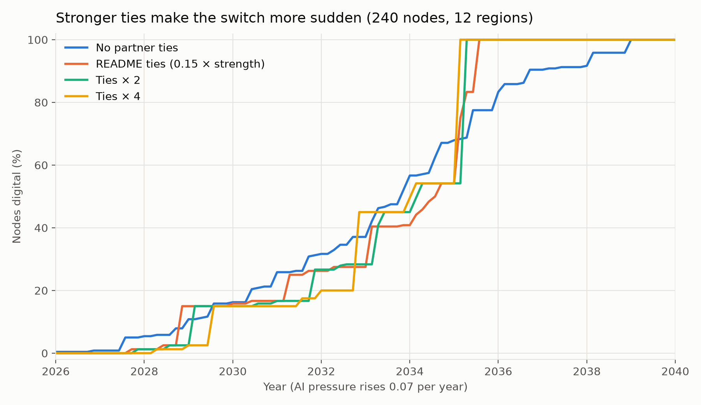

**Regional synchronization.** Regional shifts spread Legal's flip year over 2034–2038. Inter-region couplings of $J=0.05$, a third of a typical partner tie, collapse 10 of 12 regions onto 2036. Florida and New England remain early: each has a single neighbour, so its summed coupling field is smallest.

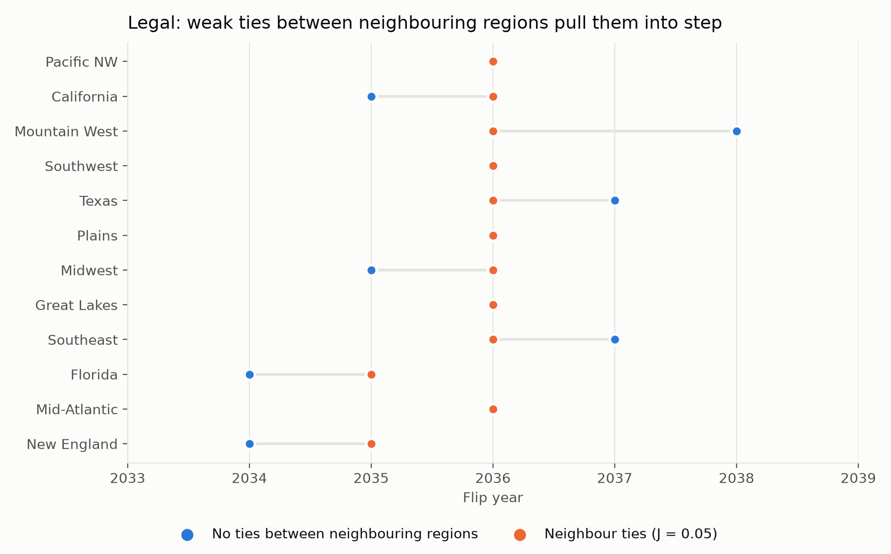

---

## 5. Quantum solution: linear-ramp QAOA

### 5.1 From the Hamiltonian to the Schrödinger equation

**One qubit per company.** Company $i$ gets qubit $i$. A 20-industry region uses 20 qubits, so the state has $2^{20}=1{,}048{,}576$ complex amplitudes, one per paper/digital arrangement.

**Operators.**

| Symbol | Meaning |
|---|---|
| $Z_i=\lvert0\rangle\langle0\rvert-\lvert1\rangle\langle1\rvert$ | reads qubit $i$: $+1$ = digital ($\lvert0\rangle$), $-1$ = paper ($\lvert1\rangle$) |
| $X_i$ | flips qubit $i$ between paper and digital |

**Problem Hamiltonian.** Replace each spin $s_i$ in $E$ by $Z_i$:

$$
H_C(A)=-\sum_{(i,j)}J_{ij}\,Z_iZ_j-\sum_i\,(A-r_i)\,Z_i,\qquad H_C\,|\mathbf s\rangle=E(\mathbf s)\,|\mathbf s\rangle .
$$

Each arrangement is an eigenstate, and its eigenvalue is exactly the classical energy.

- **First minus sign:** aligned partners ($Z_iZ_j=+1$) lower the energy by $J_{ij}$.
- **Second minus sign:** when $A>r_i$, the digital value $Z_i=+1$ lowers the energy.

**Driver Hamiltonian.** $H_D=-\sum_i X_i$. Its ground state $|+\rangle^{\otimes n}$ is the equal superposition of all $2^n$ arrangements: every company "undecided".

**Schrödinger equation.**

$$
i\hbar\,\frac{d}{dt}|\psi(t)\rangle=H(t)\,|\psi(t)\rangle,\qquad
H(t)=\Bigl(1-\tfrac{t}{T}\Bigr)H_D+\tfrac{t}{T}\,H_C(A),\qquad |\psi(0)\rangle=|+\rangle^{\otimes n}.
$$

| Symbol | Meaning |
|---|---|
| $i$ | the imaginary unit; it makes the evolution unitary, so probabilities always sum to 1 |
| $\hbar$ | the reduced Planck constant; we set $\hbar=1$, so time is in units of 1/energy |
| $t$ | time during the anneal, from $0$ to $T$ |
| $T$ | the anneal duration |
| $t/T$ | the anneal fraction, sliding the Hamiltonian from $H_D$ to $H_C$ |
| $A$ | the year's AI pressure, $0.07\,(y-2026)$, fixed during each year's anneal |

**Why $H_C$ alone is not enough.** With $H=H_C$ only, the solution is

$$
|\psi(T)\rangle=\sum_k c_k\, e^{-iE_kT/\hbar}\,|k\rangle .
$$

Each amplitude only gains a phase. Probabilities $|c_k|^2$ never change, so nothing switches. The driver $H_D$ is what moves probability between arrangements, and turning it off slowly leaves the system in $H_C$'s ground state (the adiabatic theorem). The process works when

$$
T\gg \frac{\max\lVert dH/ds\rVert}{g_{\min}^2},
$$

where $g_{\min}$ is the smallest gap between the lowest two levels along the path.

**Formal solution.**

$$
|\psi(T)\rangle=\mathcal T\exp\!\Bigl(-\tfrac{i}{\hbar}\int_0^T H(t)\,dt\Bigr)|+\rangle^{\otimes n}.
$$

- The exponent $-\tfrac{i}{\hbar}\times\text{energy}\times\text{time}$ is a phase angle.
- $\mathcal T$ (time ordering) is needed because $H_D$ and $H_C$ do not commute ($X_iZ_i=-Z_iX_i$).

**Trotterization (what the circuit computes).** Split the anneal into $p$ steps with $\Delta t=T/p$ and $t_k=k\,\Delta t$:

$$
e^{-iH(t_k)\Delta t}\approx e^{-i(1-t_k/T)\Delta t\,H_D}\;e^{-i(t_k/T)\Delta t\,H_C},
$$

with error $O(\Delta t^2)$ per step. Setting $\gamma_k=(t_k/T)\Delta t$ and $\beta_k=(1-t_k/T)\Delta t$ gives exactly the circuit of §5.2, with $\Delta t=1$ and $T=p$ in units where the largest coefficient is 1.

The factor 2 in the gates comes from $R_Z(\theta)=e^{-i\theta Z/2}$:
- $e^{-i\gamma hZ}=R_Z(2\gamma h)$;
- $e^{-i\beta H_D}=e^{+i\beta\sum X}=\prod R_X(-2\beta)$.

**Measurement.** The final state is

$$
|\psi(T)\rangle=\sum_{k=0}^{2^n-1}c_k\,|k\rangle,
$$

where $k$ is a bit string and bit $k_i=0$ means company $i$ is digital.

- **Born rule:** a measurement returns arrangement $k$ with probability $|c_k|^2$.
- **Company $i$'s probability of being digital:**
  $$
  P_i(\text{digital})=\sum_{k:\,k_i=0}|c_k|^2=\Bigl\langle\psi\Bigr|\tfrac{I+Z_i}{2}\Bigl|\psi\Bigr\rangle .
  $$
  Here $(I+Z_i)/2$ is the projector onto "digital".
- **Energy of the final state:**
  $$
  \langle E\rangle=\langle\psi|H_C|\psi\rangle=\sum_k|c_k|^2E_k\;\ge\;E_0,
  $$
  with equality only if all the probability sits on ground states.

**What these probabilities mean.** The model itself is deterministic. In the ideal (slow) limit every $P_i$ is exactly 0 or 1 and reproduces the exact flip years. Intermediate values measure how far a finite anneal is from that limit, which is largest at tipping points. They are a solver diagnostic, **not** a calibrated economic forecast.

The statement "lower energy means more likely" is exact in the thermal (Boltzmann) sense:

$$
P(\mathbf s)\propto e^{-E(\mathbf s)/\tau},
$$

where the minus sign in the exponent makes lower energies more probable. The "temperature" $\tau$ would represent market uncertainty. That is a modelling choice we did not calibrate.

### 5.2 Circuit

Prepare $|+\rangle^{\otimes n}$, the ground state of the mixer $H_M=-\sum_i X_i$. Then apply $p$ alternating layers with a linear schedule:

$$
|\psi_p\rangle=\prod_{k=1}^{p} e^{-i\beta_k H_M}\, e^{-i\gamma_k H_C/\lambda}\;|+\rangle^{\otimes n},
\qquad \gamma_k=\Delta\tfrac{k}{p},\quad \beta_k=\Delta\bigl(1-\tfrac{k}{p}\bigr),
$$

with $\Delta=1$ and $\lambda=\max(|h_i|,|\tilde J_{ij}|)$, so that the largest coefficient is 1. This is a first-order Trotterization of the adiabatic path $H(t)=(1-t)H_M+tH_C$, i.e. a gate-based quantum anneal. It needs no variational parameter search (photo 03 sketches the anneal, start to end).

**Gates.**

| Term | Gate |
|---|---|
| $e^{-i\gamma h Z}$ | $R_Z(2\gamma h)$ |
| $e^{-i\gamma \tilde J Z_iZ_j}$ | $\mathrm{CNOT}_{ij}\,R_Z^{(j)}(2\gamma\tilde J)\,\mathrm{CNOT}_{ij}$ (portable across hardware) |
| $e^{-i\beta H_M}$ | $R_X(-2\beta)$ on every qubit |

The sign of the mixer matters. With $+\sum X$, the circuit follows the *highest* energy level, and our first version returned the maximum-energy arrangement every year.

**Resources.**

| Network | Layers $p$ | Qubits | CNOTs | Depth |
|---|---|---|---|---|
| Utah | 3 | 5 | 12 | 26 |
| One region | 3 | 20 | 144 | 62 |

**Readout.** We report two numbers:
- **best-of-shots:** the lowest-energy measured arrangement, used for flip years;
- **per-shot success** $P_{\text{exact}}=\sum_{k:\,E_k=E_{\min}}|\langle k|\psi_p\rangle|^2$, against the random-guess baseline $2^{-n}$.

### 5.3 Classical vs quantum on the same networks

The networks are sub-networks of the 20-industry region (first $n$ industries by resistance). Times cover all 15 years; each is a single run on one laptop, so differences under about 2× are noise. "Lowest energy" counts the years in which the method's answer reached the minimum energy.

| $n$ | Min-cut | Brute force | Sim. annealing | QAOA ($p=30$, 1,000 shots, simulated) | QAOA $\overline{P_{\text{exact}}}$ |
|---|---|---|---|---|---|
| 5 | 0.002 s | 0.001 s | 0.05 s | 0.64 s | 0.98 |
| 8 | 0.003 s | 0.002 s | 0.08 s | 0.69 s | 0.93 |
| 12 | 0.004 s | 0.005 s | 0.11 s | 1.4 s | 0.82 |
| 16 | 0.005 s | 0.07 s | 0.16 s | 2.5 s | 0.74 |
| 20 | 0.007 s | 3.2 s | 0.17 s | 19.6 s | 0.63 |

Every method reached the lowest energy in **15/15 years at every size**. Data: [`results/classical_vs_quantum.csv`](classical_vs_quantum.csv).

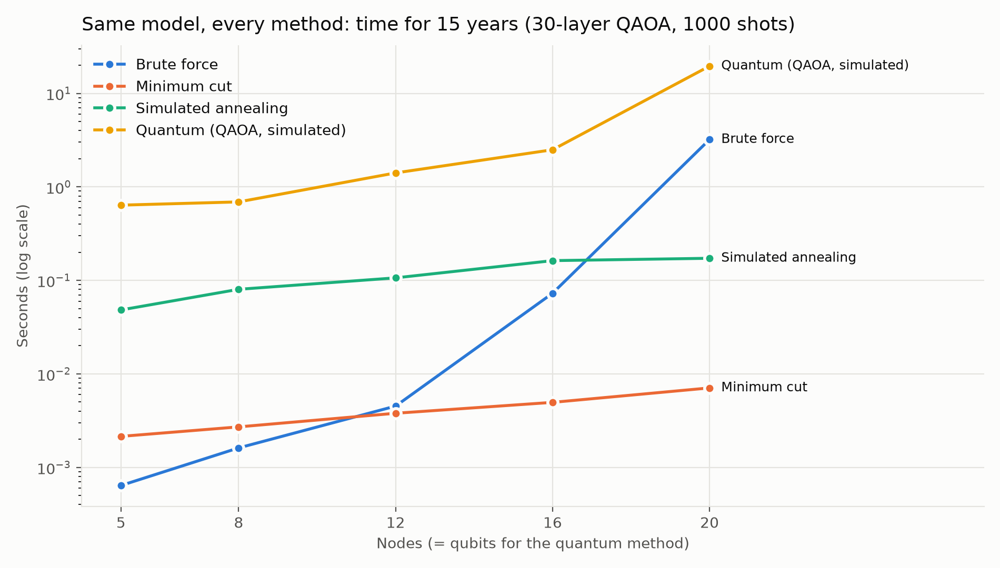

At larger sizes only the classical methods remain feasible ([fig. 05](figures/05_scaling.png)):

| $n$ | Min-cut | Sim. annealing |
|---|---|---|
| 240 | 0.14 s | 1.6 s, 100% of flip years |
| 1,920 | 1.4 s | 10.6 s, 98.6% of flip years |

Brute force at 40 nodes would take about 42 days (extrapolated from $2^n$; not run). The QAOA timings measure a classical simulation of the circuit, whose cost grows as $2^n$. They say nothing about runtime on quantum hardware, which we have not yet measured.

### 5.4 Depth and the spectral gap

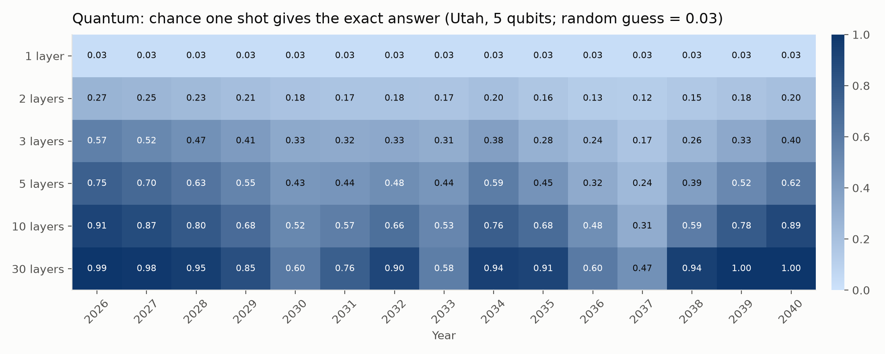

For Utah:

| Layers $p$ | Mean $P_{\text{exact}}$ |
|---|---|
| 1 | 0.03 (exactly the uniform $1/32$: with $p=1$, $\beta_1=0$, so the circuit only adds phases) |
| 3 | 0.35 |
| 30 | 0.83 |

The hardest year at every depth is **2037**, the year Healthcare and Government flip together; there $P_{\text{exact}}=0.47$ at $p=30$.

The adiabatic theorem requires a run time scaling as $T\sim1/\Delta_{\min}^2$, where $\Delta_{\min}$ is the minimum gap along the interpolation path. As a proxy we use the final classical gap $\delta(y)=E_1-E_0$ of $H_C(y)$.

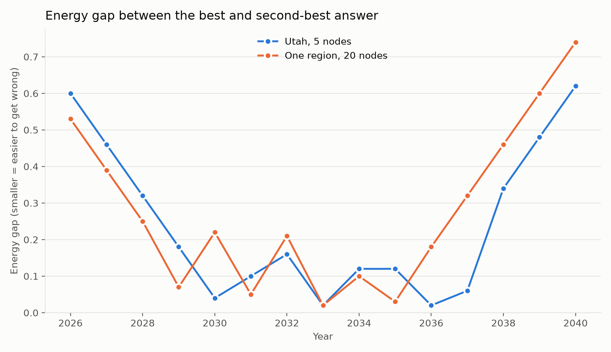

$\delta$ dips at the tipping years: 2030, 2033, 2036 and 2037 for Utah. Across the 15 years, $P_{\text{exact}}$ at $p=3$ correlates with $\delta$ at $r=0.66$.

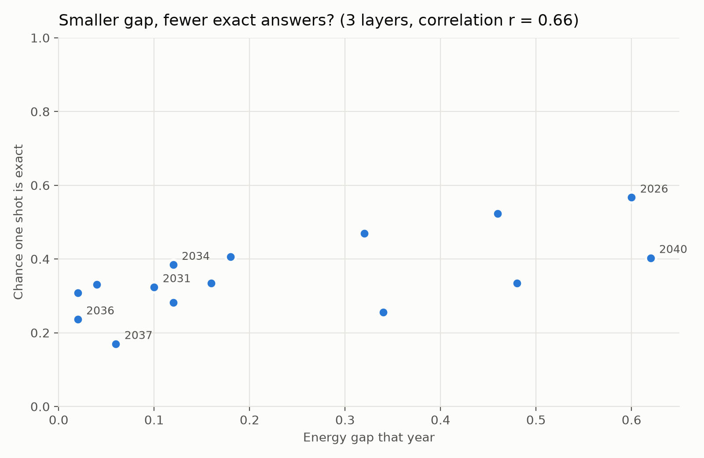

This is a small sample of 15 points, and the final gap is only a proxy for $\Delta_{\min}$. Still, the direction is the one the theory predicts: **quantum errors concentrate at the economy's critical points.** On noisy hardware the same years should fail first.

### 5.5 Structure of the quantum state

**Density matrix.** Utah, 2037, $p=30$, restricted to the 8 most probable basis states. These carry essentially all the probability.

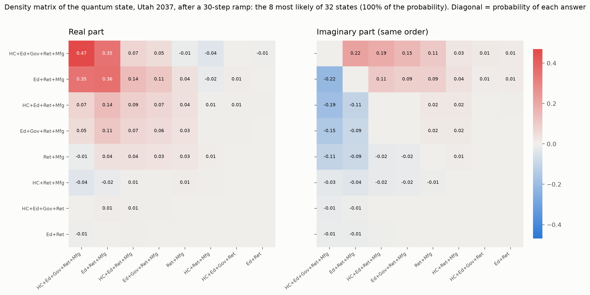

- The state is dominated by $|\text{all digital}\rangle$ ($\rho_{kk}=0.47$, the exact answer) and $|\text{HC, Gov paper; rest digital}\rangle$ ($0.36$).
- Their coherence is $|\rho_{kl}|\approx0.41$ (real 0.35, imaginary 0.22), close to the maximum $\sqrt{0.47\cdot0.36}\approx0.41$ for a pure state. It is a superposition of "both flip" and "both wait".
- States in which Healthcare and Government disagree are suppressed (≤ 0.09).

**Entanglement follows the couplings.** For two qubits we compute the reduced state $\rho_{AB}=\mathrm{Tr}_{\overline{AB}}\,\rho$ and the Wootters concurrence

$$
C(\rho_{AB})=\max(0,\lambda_1-\lambda_2-\lambda_3-\lambda_4),
$$

where $\lambda_i$ are the decreasing square roots of the eigenvalues of $\rho_{AB}\,(\sigma_y\otimes\sigma_y)\,\rho_{AB}^{*}\,(\sigma_y\otimes\sigma_y)$.

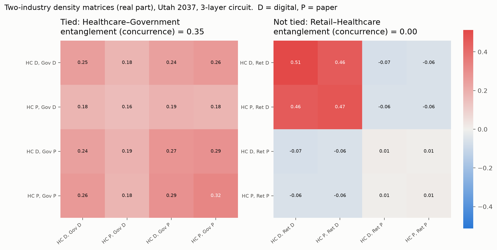
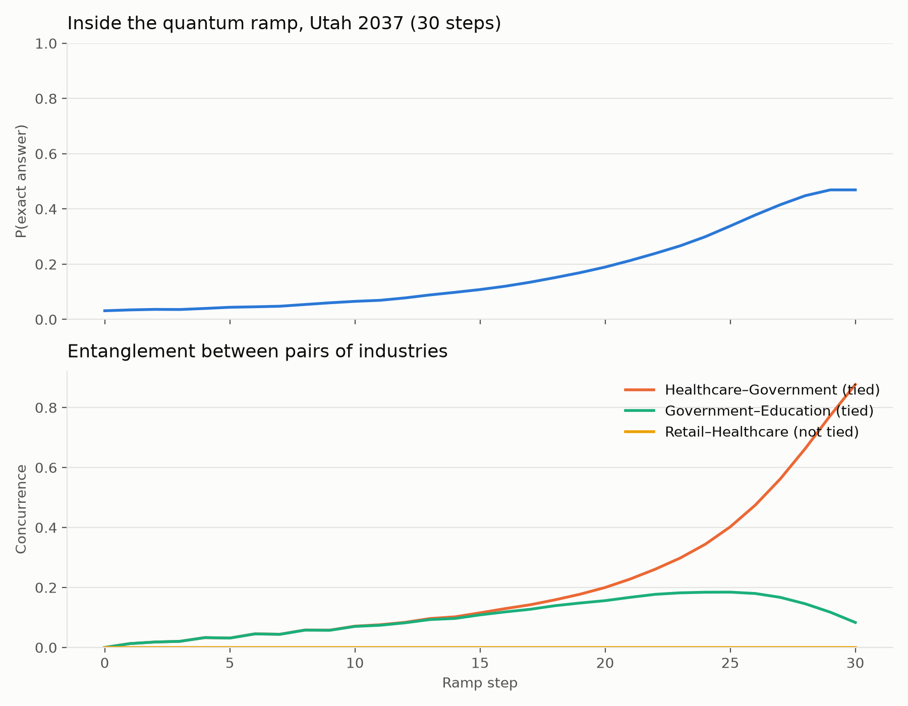

| Pair | Coupled? | $C$ at $p=3$ | Peak $C$ during the 30-step ramp |
|---|---|---|---|
| Healthcare–Government | yes | 0.35 | 0.88 |
| Government–Education | yes | — | ≈ 0.18, then falls |
| Retail–Healthcare | no | 0.00 | 0.00 at every step |

The zero is exact, not numerical. Retail appears in no $Z_iZ_j$ term, so every gate touching it is single-qubit, and the state factorizes as $|\psi\rangle=|\phi_{\text{Retail}}\rangle\otimes|\chi_{\text{rest}}\rangle$ at every step. This makes the whiteboard's "quadratic biases = entanglement → ties" precise: **the $ZZ$ couplings are the only entangling operations, so entanglement can only form along the business network.** Uncoupled pairs that share a neighbour (e.g. Healthcare–Education through Government) can still become entangled indirectly.

**Caveat.** An ideal adiabatic evolution ends in the product state $|\mathbf s^\*\rangle$, with $C=0$. The large final concurrence in 2037 is a diabatic residue. It is the same small-gap effect as in §5.4: the ramp has not finished separating "both flip" from "both wait".

### 5.6 Per-company probabilities and final energy (20 qubits)

Each cell below is $P_i(\text{digital})$ from the exact final state of a 30-step anneal, for the 20-industry region (one qubit per industry). Data: [`results/quantum_probabilities.csv`](quantum_probabilities.csv).

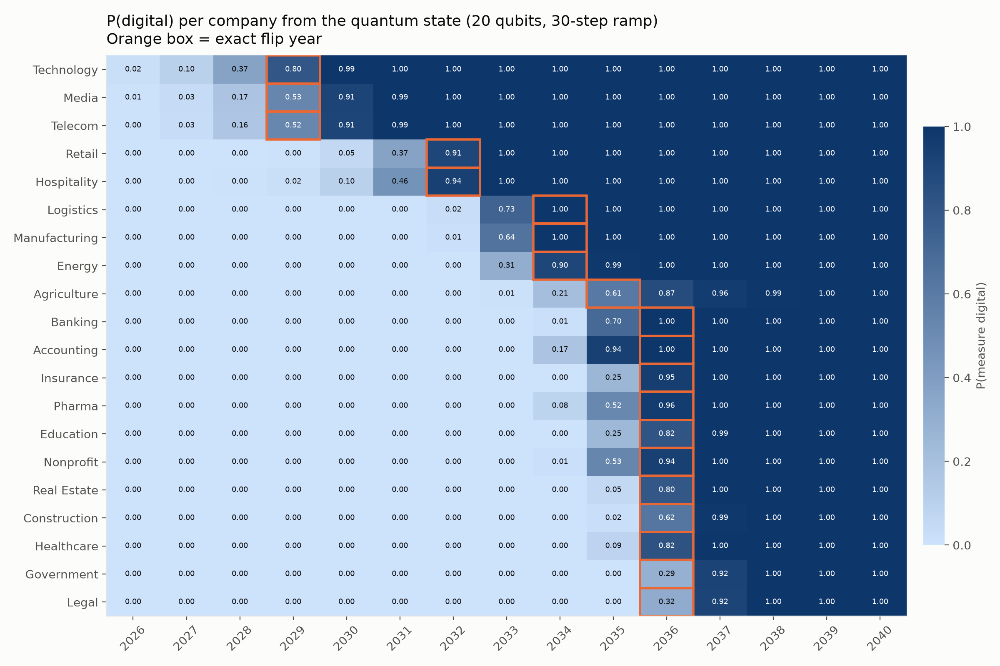

- **Agreement with the exact answer.** Calling a company digital when $P_i\ge0.5$ matches the exact answer in **292 of 300** company-years.
- **Where uncertainty sits.** It is concentrated in each cluster's flip year. Media and Telecom are at 0.53 and 0.52 in 2029. In 2036, Government is at 0.29, Legal at 0.32 and Construction at 0.62.
- **Final energy.** The excess energy $\langle E\rangle-E_0$ peaks at **0.36 in 2036**, compared with 0.02–0.15 in every other year.

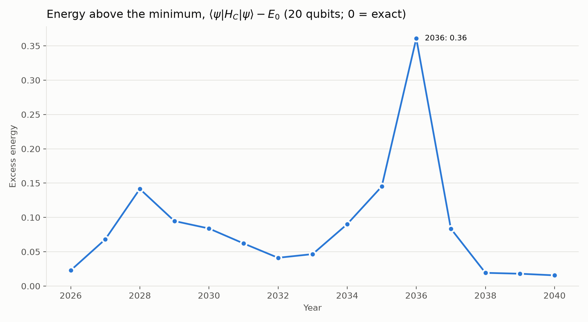

---

## 6. Where quantum helps, and where it does not

- **Accuracy.** QAOA reproduced the exact ground energy in every year up to 20 qubits on a noiseless simulator.
- **Interpretability.** Its state exposes the network's structure: entanglement only along ties, and amplitude split exactly at critical points.
- **Speed.** No advantage is possible for this model. It is a submodular minimization, solvable exactly in polynomial time. Classical simulation of the circuit is exponential, and real-hardware runtimes have not been measured.
- **Thermal vs quantum annealing.** The usual argument for quantum annealing is tunnelling through tall, thin barriers that thermal hops climb over (photo 03). Here simulated annealing already finds the ground state up to 240 nodes and errs only at 1,920 (98.6%). The landscape has no barriers that hard.

**Extensions that break the minimum-cut reduction.** These are where a quantum solver would be a genuine candidate:

1. **Competitive ties**, $J_{ij}<0$: one industry going digital pushes a rival to stay on paper. This makes the model a frustrated spin glass, NP-hard in general.
2. **The stretch-goal sales QUBO:** choose target nodes under a budget constraint, with pairwise bonuses for landing coupled nodes. A quadratic knapsack problem, NP-hard.
3. **Hysteresis:** solve year $y$ starting from year $y-1$'s state (reverse annealing) instead of the global minimum. Adoption would then lag behind pressure, which neither model above captures.

---

## 7. Limitations

- All quantum numbers come from a noiseless simulator. Hardware runs on qBraid are pending:
  - the first IonQ Forte job failed, cause unknown;
  - QuEra Aquila is analog and cannot run gate circuits.
- Parameters are the challenge's suggested values, not measured adoption data.
- Flip years come from independent yearly ground states, so there is no inertia or hysteresis.
- Timings are single runs on one laptop.
- The gap–success correlation uses 15 points and a proxy gap.

## 8. Reproducibility

```bash
pip install -r requirements.txt
python src/make_figures.py      # all figures + results/classical_vs_quantum.csv (~1 min)
python src/scaling_comparison.py
python src/quantum_qaoa.py --network utah --layers 3
```

Versions used:

| Package | Version |
|---|---|
| Python | 3.14.7 |
| qiskit | 2.6.2 |
| qiskit-aer | 0.18.2 |
| networkx | 3.7 |
| dwave-neal | 0.6.0 |
| dimod | 0.12.23 |
| numpy | 2.5.4 |
| matplotlib | 3.11.2 |
| qbraid | 0.13.0 |

`requirements.txt` pins `numpy<2.5`, because qBraid's Braket dependency (Numba) fails on 2.5. All random draws are seeded (network seed 7, annealing seed 11, simulator seed 1).
